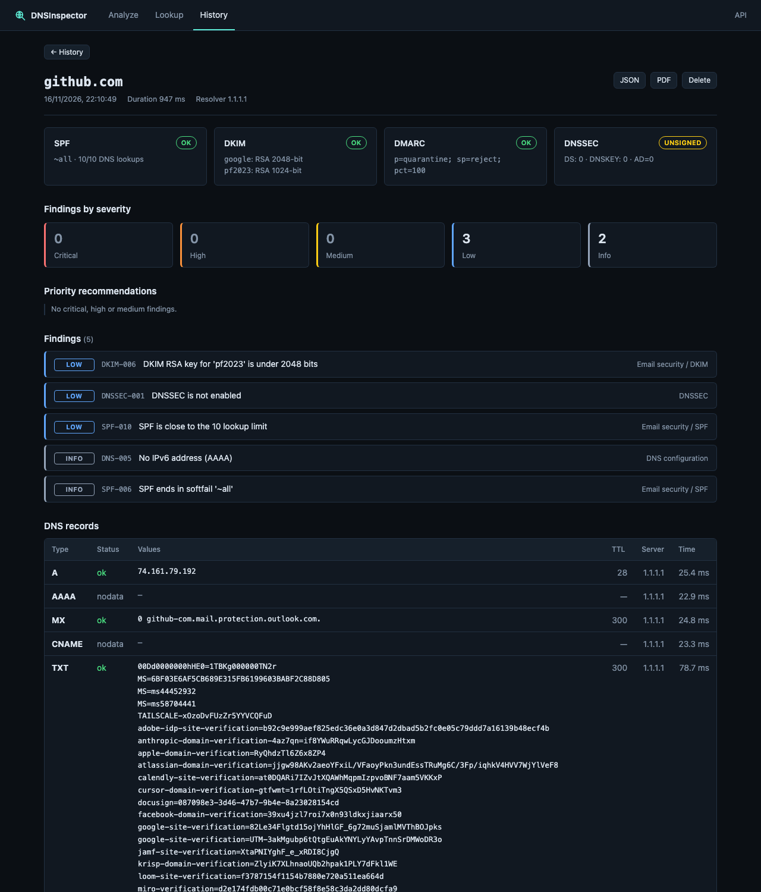
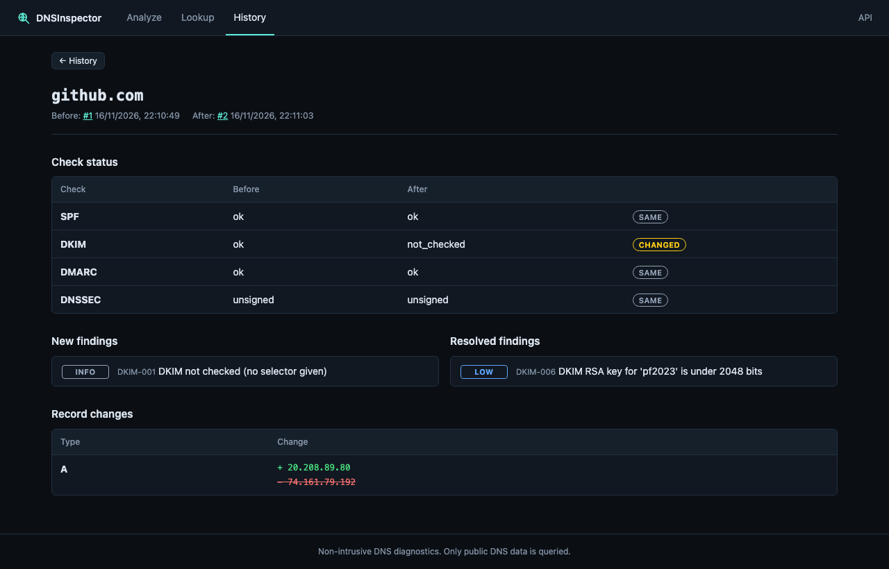

# DNSInspector

[](https://github.com/abdark0u/dnsinspector/actions/workflows/ci.yml)
[](LICENSE)

DNSInspector is a self-hosted web tool for DNS diagnostics and basic domain security
auditing. Enter a domain and it queries its DNS records, audits SPF, DKIM, DMARC and
DNSSEC, classifies the problems it finds by severity and lets you export the result as
a JSON or PDF report. Every analysis is stored so you can review it later or compare two
runs of the same domain.

It is a **non-intrusive** tool: it only sends standard DNS queries to the configured
recursive resolver. No port scans, no zone transfers, no access to private networks.



## Features

**DNS lookup**
- A, AAAA, MX, CNAME, TXT, NS and SOA records, plus PTR for public IP addresses.
- TTL, answering resolver and response time for every query.
- Each query is classified as `ok`, `nodata` (name exists, no record of that type),
  `nxdomain` (name does not exist), `timeout` or `error` (SERVFAIL, refused, ...).

**Email security audit**
- **SPF**: detects the record and duplicates, validates syntax (mechanisms, qualifiers,
  ip4/ip6 networks, modifiers), flags permissive endings (`+all`, `?all`, missing `all`),
  deprecated `ptr`, terms after `all`, and counts DNS lookups recursively through
  `include`/`redirect` to enforce the RFC 7208 limit of 10 (with loop detection).
- **DKIM**: for the selectors you provide, queries `<selector>._domainkey.<domain>`,
  validates the tag structure, decodes the public key and reports the real RSA key size
  (or Ed25519), revoked keys and test mode. It never claims a signature is valid.
- **DMARC**: queries `_dmarc.<domain>` (falling back to the parent domain for subdomains),
  parses `v, p, sp, rua, ruf, pct, adkim, aspf`, detects syntax errors, duplicate records,
  `p=none`, `sp=none`, `pct<100`, missing or invalid report URIs.

**DNSSEC audit**
- Detects DS (at the parent) and DNSKEY (in the zone) records, with key tags, algorithms
  and KSK/ZSK roles.
- Verifies **locally, with real cryptography** that a DS record matches a DNSKEY and that
  the DNSKEY RRset signature (RRSIG) is valid.
- Reports the resolver's AD (Authenticated Data) flag separately, and flags deprecated
  algorithms and SHA-1-only DS digests.
- Clearly separates "DNSSEC present" from "verified" and documents what is not verified
  (see [Limitations](#limitations)).

**Findings engine**
- Each finding has an ID, severity (Critical, High, Medium, Low, Info), title,
  description, technical evidence, recommendation, category and RFC reference.
- Severities follow fixed, documented rules: see [docs/FINDINGS.md](docs/FINDINGS.md).
  There is no invented numeric score.

**Dashboard, reports and history**
- Dark, responsive dashboard with audit status cards, findings grouped by severity,
  priority recommendations and the full record table.
- JSON and PDF report export.
- SQLite history: list, filter by domain, open, delete and compare two analyses of the
  same domain (record changes, status changes, new and resolved findings).



## Architecture

```
Browser (static HTML/CSS/JS)
        |
FastAPI  (api.py: validation, rate limiting, security headers)
   |            |             |
analyzer.py  storage.py    reports.py
   |         (SQLite)      (JSON, PDF)
audits/  spf.py  dkim.py  dmarc.py  dnssec.py  records.py
   |
dns_engine.py  (dnspython wrapper, result classification)
   |
recursive resolver(s)
```

| Path | Responsibility |
|---|---|
| `dnsinspector/config.py` | Settings from environment variables |
| `dnsinspector/validation.py` | Domain, selector and IP validation |
| `dnsinspector/dns_engine.py` | Single DNS query with status, TTL, nameserver, timing |
| `dnsinspector/audits/` | One module per audit, each returns `(status, findings)` |
| `dnsinspector/findings.py` | Finding model, severities, summary |
| `dnsinspector/analyzer.py` | Runs a full analysis and builds the report |
| `dnsinspector/storage.py` / `compare.py` | SQLite history and comparison |
| `dnsinspector/reports.py` | JSON and PDF export |
| `dnsinspector/api.py` | REST API and static frontend |
| `dnsinspector/static/` | Frontend |
| `tests/` | Pytest suite (uses a fake resolver, no Internet needed) |

More detail and the design decisions are in [docs/ARCHITECTURE.md](docs/ARCHITECTURE.md).

## Tech stack

| Component | Choice | Why |
|---|---|---|
| Language | Python 3.11+ | |
| Web framework | FastAPI + Uvicorn | Typed request validation, automatic OpenAPI docs |
| DNS | dnspython (with `dnssec` extra) | De facto DNS library; the extra brings `cryptography` for DNSSEC and DKIM key checks |
| Database | SQLite (stdlib `sqlite3`) | One table, zero setup |
| PDF | fpdf2 | Pure Python, no system dependencies |
| Frontend | HTML5, CSS3, vanilla JavaScript | Three views, no build step |
| Tests / lint | pytest, httpx, ruff | |
| Deployment | Docker, Docker Compose, GitHub Actions | |

## Requirements

- Python 3.11 or newer, **or** Docker with Docker Compose v2.24+.
- Outbound DNS (UDP/TCP 53) to the resolvers you configure.

## Installation

```bash
git clone https://github.com/abdark0u/dnsinspector.git
cd dnsinspector
python3 -m venv .venv
source .venv/bin/activate
pip install .
cp .env.example .env   # optional, see Configuration
dnsinspector
```

Open http://127.0.0.1:8000. Interactive API docs are at http://127.0.0.1:8000/api/docs.

> `dnsinspector` does not read `.env` by itself. Export the variables in your shell or
> use Docker Compose, which loads `.env` automatically.

### Configuration

| Variable | Default | Description |
|---|---|---|
| `DNS_NAMESERVERS` | system resolvers | Comma-separated resolver IPs, e.g. `1.1.1.1,8.8.8.8`. Use a validating resolver to get a meaningful AD flag. |
| `DNS_TIMEOUT` | `3` | Maximum seconds per DNS query |
| `DATABASE_PATH` | `data/dnsinspector.db` | SQLite file (created automatically) |
| `RATE_LIMIT_PER_MINUTE` | `30` | Lookup/analysis requests per client IP per minute (`0` disables) |
| `LOG_LEVEL` | `INFO` | `DEBUG`, `INFO`, `WARNING`, `ERROR` |
| `HOST` / `PORT` | `127.0.0.1` / `8000` | Listen address (Docker uses `0.0.0.0`) |

## Docker deployment

```bash
cp .env.example .env    # optional
docker compose up -d --build
```

The app listens on http://127.0.0.1:8000 (bound to localhost on purpose). History is kept
in the `dnsinspector-data` volume. The container runs as a non-root user and has a health
check on `/api/health`. If you expose it beyond localhost, put a reverse proxy with TLS in
front of it.

## Local development

```bash
python3 -m venv .venv
source .venv/bin/activate
pip install -e ".[dev]"
uvicorn dnsinspector.api:create_app --factory --reload
```

```bash
ruff check . && ruff format --check .
pytest
```

## Usage examples

**Web UI**: open the *Analyze* tab, type a domain and (optionally) DKIM selectors, e.g.
`google` for Google Workspace or `selector1, selector2` for Microsoft 365. You can find the
selector in the `s=` field of the `DKIM-Signature` header of an email sent by the domain.

**API**:

```bash
# Full analysis (stored in history)
curl -s -X POST http://127.0.0.1:8000/api/analyses \
  -H 'Content-Type: application/json' \
  -d '{"domain": "example.com", "dkim_selectors": ["google"]}'

# Single lookup and PTR
curl -s 'http://127.0.0.1:8000/api/lookup?name=example.com&type=MX'
curl -s 'http://127.0.0.1:8000/api/lookup?name=8.8.8.8'

# Reports
curl -o report.pdf http://127.0.0.1:8000/api/analyses/1/report.pdf

# Compare two analyses of the same domain
curl -s 'http://127.0.0.1:8000/api/compare?a=1&b=2'
```

## API endpoints

| Method | Path | Description |
|---|---|---|
| GET | `/api/health` | Health check and version |
| GET | `/api/lookup?name=&type=` | Query one type (`A`, `AAAA`, `MX`, `CNAME`, `TXT`, `NS`, `SOA`) or `ALL`; a public IP returns its PTR. Rate limited. |
| POST | `/api/analyses` | Run and store a full analysis. Body: `{"domain": str, "dkim_selectors": [str] (max 5)}`. Rate limited. |
| GET | `/api/analyses?domain=&limit=&offset=` | List history (newest first) |
| GET | `/api/analyses/{id}` | Full stored report |
| DELETE | `/api/analyses/{id}` | Delete from history |
| GET | `/api/analyses/{id}/report.json` | Download JSON report |
| GET | `/api/analyses/{id}/report.pdf` | Download PDF report |
| GET | `/api/compare?a=&b=` | Compare two analyses of the same domain |

Invalid input returns `422` with a readable message; rate limiting returns `429`.
OpenAPI documentation is served at `/api/docs`.

## Testing

```bash
pytest -q
```

The suite (110+ tests) runs offline: a fake resolver returns real dnspython RRsets, so
parsing and classification are exercised without network access. It covers:

- DNS engine: found records, NODATA, NXDOMAIN, timeout, SERVFAIL, TXT joining, MX
  ordering, PTR, AD flag.
- Input validation: domains, IDN, reserved TLDs, injection-like input, selectors, private IPs.
- SPF, DKIM (with real generated RSA/Ed25519 keys), DMARC.
- DNSSEC with **real signed test zones** (valid chain, DS mismatch, bad RRSIG, DS without
  DNSKEY, SHA-1 DS).
- Findings, analyzer, SQLite storage, comparison, JSON/PDF export and every API endpoint,
  including rate limiting and security headers.

GitHub Actions runs lint and tests on Python 3.11 and 3.13, then builds the Docker image,
starts it with Compose and runs a real analysis plus a PDF download against it.

## Limitations

- **DNSSEC**: DNSInspector verifies the DS -> DNSKEY link and the DNSKEY RRset signature.
  It does **not** validate the whole chain of trust from the root, does not verify the
  signatures of other RRsets (A, MX, ...) and does not check NSEC/NSEC3 denial of
  existence. The AD flag is reported as returned by the resolver and only means something
  if that resolver validates and the path to it is trusted.
- **DKIM**: selectors cannot be discovered through DNS, so only the selectors you provide
  are checked. A valid key record does not prove that mail is signed correctly; that needs
  a real signed message.
- **DMARC** organizational domain fallback uses the last two labels instead of the Public
  Suffix List, so it is inaccurate for domains such as `example.co.uk`. External report
  destination authorization (RFC 7489 section 7.1) is not checked.
- **SPF**: macros (e.g. `%{i}`) cannot be expanded without a real message, so includes
  that use them are counted but not followed. The "void lookup" limit is not checked.
- Results come from a recursive resolver, so they can be cached (see the TTL). Lame
  delegations and inconsistencies between authoritative servers are not detected.
- The rate limiter is in-memory and per process. Run a single worker, or rate-limit at a
  reverse proxy.
- PDF reports use the built-in PDF fonts (Latin-1); other characters are replaced by `?`.
- There is no authentication: anyone who can reach the app can see and delete the
  history. Keep it on localhost or behind an authenticating proxy.

## Security considerations

- All user input (domains, selectors, IPs) is validated server-side before any query.
  Private and reserved names (`localhost`, `.local`, `.internal`, `home.arpa`, ...) and
  non-public IP addresses are rejected.
- No shell commands are executed; all DNS work goes through dnspython.
- Every DNS query has a timeout, SPF include resolution stops at the 10-lookup limit,
  analyses accept at most 5 DKIM selectors and requests are rate limited per IP.
- SQL uses parameterized queries only. Frontend output is HTML-escaped and the app sends
  a `default-src 'self'` Content-Security-Policy, `X-Content-Type-Options: nosniff` and
  `Referrer-Policy: no-referrer`.
- Only public DNS data is stored. No secrets are needed or stored.
- The Docker image runs as a non-root user and Compose binds the port to localhost.

See [SECURITY.md](SECURITY.md) for how to report a vulnerability.

## Roadmap

- Full DNSSEC chain validation from the root and NSEC/NSEC3 checks.
- Public Suffix List support for DMARC organizational domains.
- Checks against each authoritative name server (consistency, lame delegation, SOA serials).
- MTA-STS, TLS-RPT and BIMI record checks.
- Probing a list of common DKIM selectors (opt-in).
- CLI mode for scripted audits.
- Optional authentication for multi-user deployments.

## License

[MIT](LICENSE)
